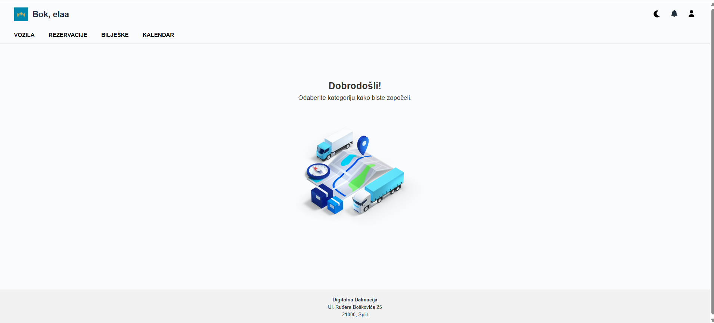
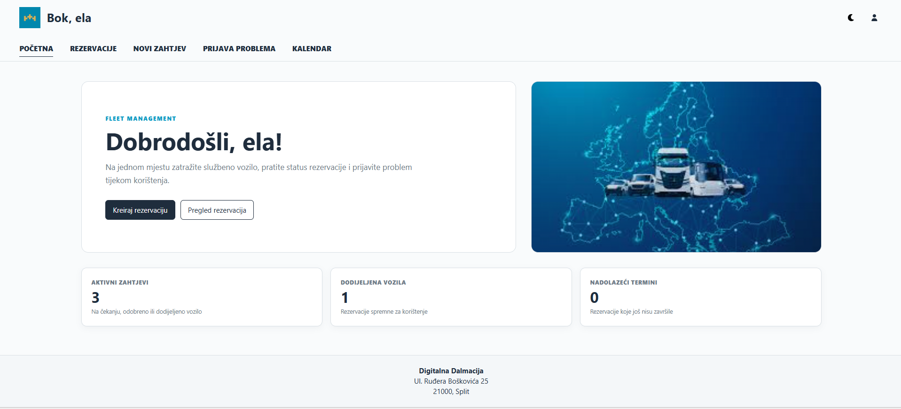
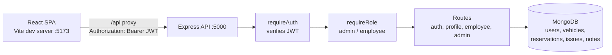

# Fleet Management System

A full-stack web application for managing a company's vehicle fleet. Employees request company vehicles, track their reservations and report problems; administrators approve requests, assign vehicles, manage the fleet and keep notes on a shared calendar. Built as a project in a web development course organised by Digitalna Dalmacija.

**Stack:** React 18 + Vite · Node.js + Express · MongoDB + Mongoose · JWT authentication · bcrypt

| Admin dashboard | Employee dashboard |
|---|---|
|  |  |

---

## Features

**Employee**
- Request a vehicle: dates, preferred vehicle type and purpose of the trip
- See all own reservations with their status (pending → approved → vehicle assigned → completed)
- Cancel a reservation before it starts
- Report a problem or damage for a reservation with an assigned vehicle
- Calendar with highlighted reservation days

**Administrator**
- Approve or reject requests and assign an available vehicle
- Add and delete vehicles; a vehicle in an active reservation cannot be deleted
- Notifications for vehicle registrations that expire within 7 days
- See problems reported by employees next to the related reservation
- Notes and a calendar showing reservations and notes per day

**Both roles**
- Profile with password change, profile picture and account deletion
- Light and dark theme
- Finished reservations are marked as completed automatically and their vehicles become available again

---

## Architecture



**Security**
- Passwords are hashed with bcrypt; login returns a JWT valid for one hour.
- Every API route except login and registration requires a valid token, and admin and employee routes check the role on the server. The frontend route guard only controls navigation.
- The user is always taken from the verified token, never from the request body, so users can only read and change their own reservations and profile.
- Self-registration always creates an employee account; admin accounts are created with a server-side script.
- Login returns the same error for an unknown email and a wrong password.
- Input is validated with `express-validator`; vehicle updates accept only whitelisted fields.

### Reservation lifecycle

| Status | Set by | Meaning |
|---|---|---|
| `pending` | employee creates the request | waiting for the administrator |
| `approved` / `rejected` | administrator | request accepted or declined |
| `vehicle assigned` | administrator | a free vehicle is reserved (taken atomically, so it cannot be assigned twice) |
| `cancelled by user` | employee, before the start date | kept for the administrator's overview |
| `expired` | server, hourly | end date passed, vehicle released |

---

## Getting started

### Prerequisites

- Node.js 18 or newer
- MongoDB running locally (default `mongodb://localhost:27017`) or a MongoDB Atlas connection string

### 1. Backend

```bash
git clone https://github.com/antonela-kovic/fleet-management-system.git
cd fleet-management-system
npm install
cp .env.example .env        # then set JWT_SECRET to a long random value
npm run create-admin -- admin@example.com "a-strong-password" "Admin Name"
npm run dev                 # http://localhost:5000
```

### 2. Frontend (second terminal)

```bash
cd fleet-management-frontend
npm install
npm run dev                 # http://localhost:5173
```

Register a new account for the employee view, or log in with the admin account created above. Using two browser tabs, an admin and an employee can be logged in at the same time (the session is stored per tab).

### Environment variables

| Variable | Description |
|---|---|
| `MONGO_URI` | MongoDB connection string |
| `JWT_SECRET` | Secret for signing tokens |
| `PORT` | Backend port (default 5000) |
| `CLIENT_URL` | Frontend origin allowed by CORS (default `http://localhost:5173`) |

---

## API overview

| Method | Endpoint | Role | Description |
|---|---|---|---|
| POST | `/api/auth/register` | public | Create an employee account |
| POST | `/api/auth/login` | public | Log in, returns a JWT |
| GET / PUT | `/api/profile/image` | any | Own profile picture |
| PUT | `/api/profile/password` | any | Change own password |
| DELETE | `/api/profile` | any | Delete own account |
| GET / POST | `/api/employee/reservations` | employee | Own reservations / new request |
| PATCH | `/api/employee/reservations/:id/cancel` | employee | Cancel before the start date |
| POST | `/api/employee/report-problem` | employee | Report a problem for an assigned vehicle |
| GET | `/api/admin/reservations` | admin | All reservations |
| PUT / DELETE | `/api/admin/reservations/:id` | admin | Approve, reject, assign a vehicle / delete |
| GET / POST | `/api/admin/vehicles` | admin | Fleet / add a vehicle |
| PUT / DELETE | `/api/admin/vehicles/:id` | admin | Update / delete a vehicle |
| GET | `/api/admin/vehicles/upcoming-registration` | admin | Registrations expiring within 7 days |
| GET / PUT / DELETE | `/api/admin/issues(/:id)` | admin | Reported problems |
| GET / POST / PUT / DELETE | `/api/admin/notes(/:id)` | admin | Notes |

---

## Testing

```bash
npm test                                   # backend access-control and validation tests (Jest + Supertest)
cd fleet-management-frontend && npm run lint && npm run build
```

The backend tests check that protected routes reject missing, invalid and forged tokens, that each role is limited to its own routes, and that invalid input is rejected. They run without a database. GitHub Actions runs the tests, the lint and the frontend build on every push.

---

## Project structure

```
├── app.js                 # Express app: middleware and routes
├── server.js              # MongoDB connection, expiry job, HTTP server
├── middleware/auth.js     # requireAuth (JWT) and requireRole
├── models/                # User, Vehicle, Reservation, Issue, Note
├── routes/                # auth, profile, employee, admin
├── services/              # reservation expiry
├── scripts/createAdmin.js # creates or promotes an admin account
├── tests/                 # Jest + Supertest
└── fleet-management-frontend/
    └── src/
        ├── components/PrivateRoute.jsx
        ├── pages/         # Login, Register, AdminDashboard, EmployeeDashboard, ProfilePopup
        └── services/api.js  # axios instance that attaches the JWT
```

## Possible improvements

- Integration tests against a test database (e.g. `mongodb-memory-server`)
- Pagination and filtering for reservations
- Storing profile pictures in object storage instead of base64 in MongoDB
- Email notifications for request status changes

## Author

Antonela Ković – [GitHub](https://github.com/antonela-kovic)
